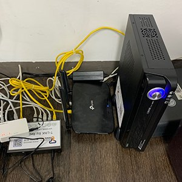
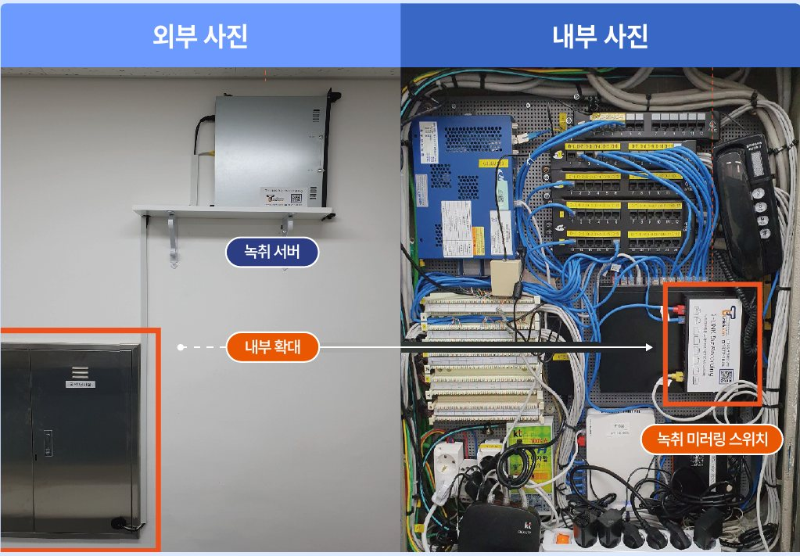
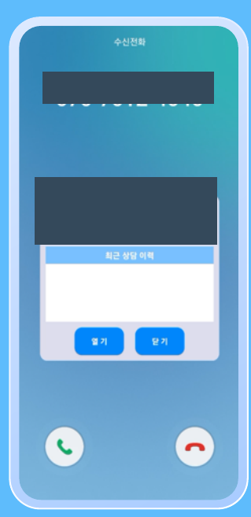
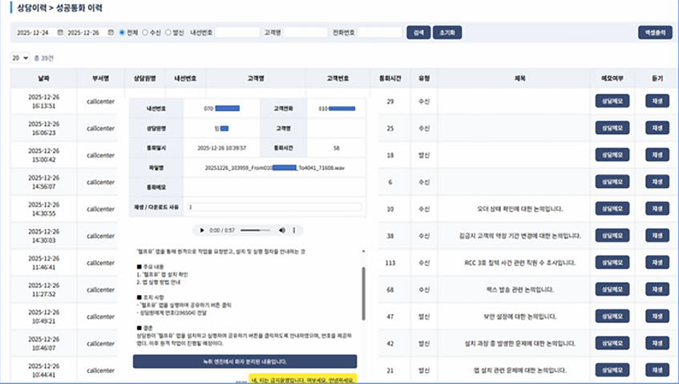
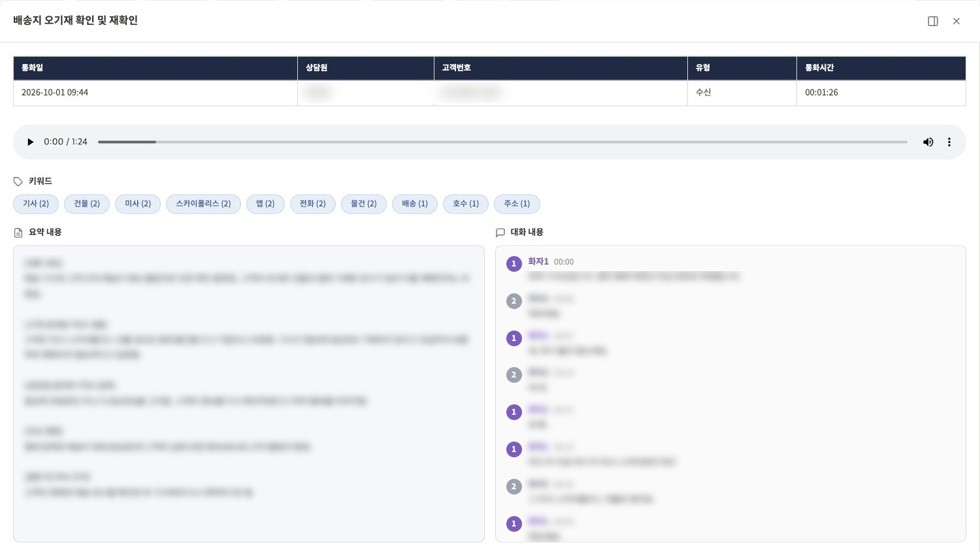
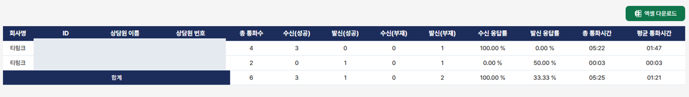
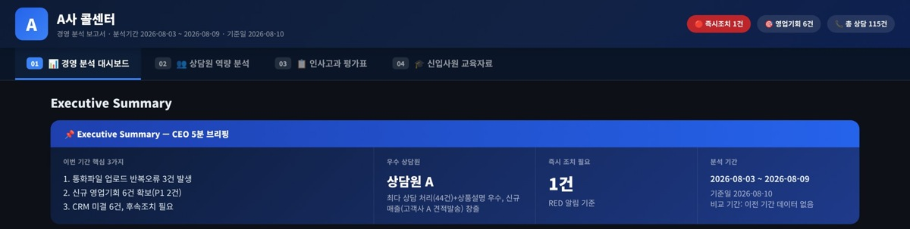

# 담당자가 바뀔 때마다 고객이 같은 요청을 다시 설명하나요? | 티링크 비즈레코딩의 영업사원 통화관리와 통화요약 · 휴대폰 통화녹음, 인터넷전화 자동녹취, 콜센터 프로그램 업무자동화

금요일에 견적서를 다시 보내 달라고 했는데 월요일에 “어떤 견적서였죠?”라는 답이 돌아온다면, 고객은 같은 일을 두 번 해야 합니다. 티링크 비즈레코딩은 영업사원 통화관리 과정에서 휴대폰 통화녹음과 인터넷전화 자동녹취 기록을 모아, 이전 약속과 다음 연락을 고객의 상담 이력에서 이어 볼 수 있습니다. **활용 예시**로 고객 한 분의 요청을 따라가 보겠습니다.

## “월요일 오전 10시 전까지요.” 메모에는 ‘견적 문의’만 남았습니다

월요일 상담원이 ‘견적 문의’라는 메모를 읽으면 새 견적을 내야 할지, 보냈던 파일을 다시 보내면 될지부터 확인해야 합니다. 이 고객이 원한 것은 **이전과 같은 조건의 견적서**입니다. 받는 곳은 기존 구매팀 메일이고, 필요한 시점은 월요일 오전 10시 전입니다. 이 세 가지를 남겨 두면 월요일 담당자는 고객에게 같은 설명을 다시 부탁할 필요가 없습니다.

*‘엠서\*\*\*\*’의 녹취 서버 설치 현장입니다. 견적서 재발송 장면은 별도로 구성한 활용 예시입니다.* [티링크 공식 설치사례](https://www.tlinkcrm.com/case.php)

**단자함에 서버를 넣을 자리가 없다면 어떻게 할까요?**

티링크 공식 사례에 나온 은평\*\*\*클럽도 같은 고민이 있었습니다. 이곳은 녹취 서버를 벽면 받침대에 두고 단자함 안에는 미러링 스위치만 넣었습니다. 덕분에 서버 본체가 단자함 안에 들어갈 자리를 따로 마련할 필요가 없었습니다.

*은평\*\*\*클럽 실제 설치사진. 왼쪽과 오른쪽은 같은 현장입니다.* [티링크 설치사례](https://www.tlinkcrm.com/case.php)

별도 서버 랙이 없는 사무실에는 본체를 한쪽에 세우는 스탠드형이 있습니다. 기존 랙이 있는 곳은 렉거치형으로 녹취 서버와 네트워크 장비를 함께 관리할 수 있습니다. 티링크는 자리가 좁은 소규모 현장에 소형 미러링 스위치 허브를 추가하는 방식도 안내합니다.

## 휴대폰으로 받은 약속을 사무실에서도 확인하려면

휴대폰과 사무실 인터넷전화, 재택 PC폰을 연동하면 여러 단말의 통화를 자동으로 녹음해 한곳에 모을 수 있습니다. 이 예시에서 금요일 외근 직원은 업무용 휴대폰의 녹음 파일이 서버로 전송됐는지 확인하고, 고객의 상담 이력에 통화를 연결합니다. 금요일 통화에서 다음 사람이 알아야 할 것은 파일, 받는 곳, 마감입니다.

> **금요일 고객 요청 · 활용 예시** “가격을 바꿔 달라는 건 아니고요. 지난번 견적서 그대로 구매팀 메일로 다시 보내 주세요. 월요일 오전 10시 회의에서 볼 거예요.”

*제품 자료 예시 · 공식 모바일 소개에 실린 수신 화면입니다. 연락처와 식별 정보는 가렸습니다. 전송되지 않은 파일은 앱의 미전송 목록에서 확인할 수 있습니다. 티링크가 안내하는 모바일 CRM 지원 범위는 안드로이드 10.0 이상이며 아이폰은 지원 대상에서 제외됩니다.* [티링크 모바일](https://www.tlinkcrm.com/mobile.php)

## 고객에게 다시 묻기 전에 확인할 수 있는 것

상담원은 CRM의 ‘통화이력’에서 금요일 날짜와 고객 정보로 통화를 찾습니다. 통화요약을 열어 요청이 재발송이라는 점을 확인하고, 마감 시각처럼 중요한 대목은 문자로 변환된 대화(STT)나 원본 녹취와 대조합니다. 이 콜센터 프로그램에서 업무자동화가 맡는 부분은 통화 내용을 글로 옮기고 요약하는 일입니다. 핵심 키워드와 요약이 자동으로 기록되므로 어떤 요청과 후속 조치가 오갔는지 살펴볼 수 있습니다. 한 통화의 요약과 원문을 함께 볼 수 있어, 담당자는 요청의 요지를 먼저 찾고 정확한 마감만 다시 들을 수 있습니다. 보낼 파일과 수신처는 상담원이 지난 발송 메일에서 직접 확인합니다.

*제품 자료 예시 · 공식 녹취 제품 페이지의 ‘성공통화 이력’입니다. 조회한 통화의 녹취와 재생 버튼을 확인할 수 있습니다.* [티링크 AI 녹취](https://www.tlinkcrm.com/recording.php)

*제품 자료 예시 · 키워드 아래에 ‘요약 내용’과 ‘대화 내용’이 나란히 표시됩니다. 그림은 제품 제안서에 수록된 다른 통화의 예시입니다.*

## 메일을 보낸 일과 고객이 받은 일은 다릅니다

상담원은 이전에 보낸 PDF와 구매팀 메일 주소를 대조해 견적서를 다시 보냅니다. 이때 상담 메모는 **‘재발송 완료 · 수신 확인 대기’**입니다. 이어 사무실 인터넷전화로 구매팀에 연락합니다. 고객이 파일을 열었다고 답하면 월요일 통화를 같은 고객의 상담 이력에 연결하고 **‘구매팀 수신 확인’**을 남깁니다. 전화가 닿지 않으면 다음 연락 시각을 적습니다. 다음 사람이 고객 기록을 열었을 때는 ‘메일을 보냈다’와 ‘고객이 받았다’를 구분할 수 있습니다.

## 우리 회사에는 통화 이력만 필요할까요, 보고서도 필요할까요?

직원별 일일 통계에서 수신·발신 건수와 평균 통화시간을 보면 월요일에 어느 상담원이 전화를 많이 받았는지 살필 수 있습니다. 특정 견적서가 고객에게 도착했는지는 해당 고객의 상담 결과에서 확인합니다.

*제품 자료 예시 · 상담원별 통계표입니다. 직원 식별 정보는 가려져 있습니다.*

경영진에게 주간 현황을 보고할 때는 종합 리포트에서 미결 건을 살핍니다. 결과를 비워 둔 상담도 미결로 집계될 수 있어, 팀장은 해당 건의 메모와 마지막 연락을 열어 본 뒤 다음 담당자를 정합니다. 통계와 리포트에는 매니저 이상 권한이 필요합니다. 공식 견적표에서 문자 변환·요약과 일일보고서는 A타입에 포함됩니다. 경영분석용 종합 리포트는 A타입에서 선택하는 추가 옵션입니다. 하루 통화 내용을 일일 보고서에 다시 옮기는 일을 줄이고 싶다면 일일보고서가 필요한지 먼저 살펴보세요. 상담 코칭과 성과관리가 목적이라면 담당자별 역량·인사평가와 신입 교육에 쓸 수 있는 통화 사례도 검토할 만합니다. 조직과 직원의 영업 현황을 살피는 경영진은 경영 대시보드에서 고객 이탈 위험 신호도 점검할 수 있습니다.

*제품 자료 예시 · ‘경영 분석 대시보드’ 상단의 CEO 브리핑입니다. 화면의 수치는 제안서에 쓰인 예시입니다.* [공식 보고서 예시](https://www.tlinkcrm.com/management.php)

공식 녹취 안내에는 KT·SK·LG 회선 연동이 명시돼 있습니다. 재택 직원이 PC폰으로 녹음하려면 계정도 확인해야 합니다. PC폰 v1.0 매뉴얼의 녹음 기능은 삼성 070 계정에서 사용할 수 있습니다. 녹취 파일에는 AES-256 암호화가 적용됩니다. 비밀번호 보호에는 SHA-256 해시를 사용합니다. 통화정보는 사용자별 접근권한에 따라 열람 범위를 관리합니다.

견적서를 기다리는 고객에게 중요한 건 약속한 때에 파일을 받는 일입니다. 티링크 비즈레코딩은 그 약속이 담긴 영업 통화를 기록하고, 아직 연락이 필요한 고객과 상담 현황을 경영 판단에 쓸 정보로 정리하는 기업용 영업관리 솔루션입니다.

**우리 회사 전화 환경에서 쓸 수 있는지 상담해 보세요.** 사용 중인 전화 종류와 이용 인원을 알려 주세요. 장비 둘 곳이 고민이라면 단자함이나 서버 랙 사진도 함께 보내 주세요. 티링크가 현장에 맞는 설치 방법을 안내합니다. [상담 신청](https://www.tlinkcrm.com/center.php) · **1877-3836**

[티링크 공식 홈페이지](https://www.tlinkcrm.com/) · [티링크 공식 블로그](https://blog.naver.com/mobilecrm)

#티링크 #콜센터 #고객상담 #콜센터프로그램 #고객관리프로그램 #CRM프로그램 #녹음 #녹취 #인터넷전화 #CRM #영업사원 통화관리 #고객관리 #티링크 #업무자동화 #STT #문자변환 #음성요약 #회의록작성 #휴대폰녹음 #종합리포트
